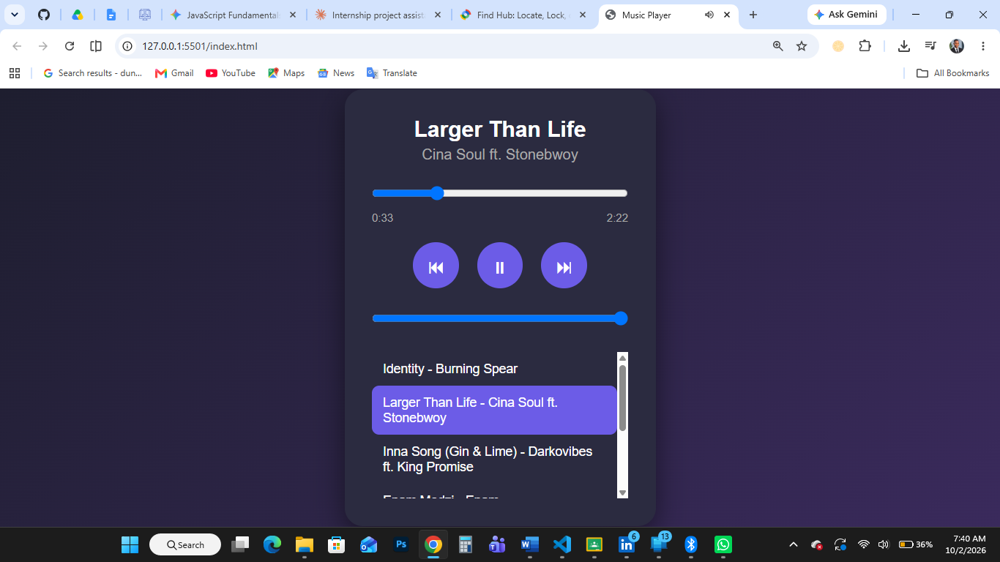

# 🎵 Music Player

A responsive, browser-based music player built with **HTML, CSS, and vanilla JavaScript**. It plays a playlist of songs with full audio controls, a live progress bar, and volume control.



**Live Demo:** [View it here](YOUR-GITHUB-PAGES-LINK)

---

## Features

- **Playback controls:** play, pause, next, and previous
- **Song details:** shows the song title, artist, and duration
- **Progress bar:** updates in real time and can be dragged to seek to any point in the song
- **Time display:** current time and total duration in `m:ss` format
- **Volume control:** slider to adjust the volume
- **Playlist:** clickable list of all songs, with the current song highlighted
- **Autoplay:** the next song starts automatically when the current one ends
- **Looping playlist:** going past the last song returns to the first, and previous on the first song goes to the last

## Technologies Used

- HTML5 (including the `<audio>` element)
- CSS3 (Flexbox, gradients, transitions)
- JavaScript (DOM manipulation, event listeners, the HTMLMediaElement API)

## Project Structure

```
music-player/
├── index.html
├── style.css
├── script.js
├── screenshot.png
├── README.md
└── songs/
    ├── song-1.mp3
    ├── song-2.mp3
    └── ...
```

## How to Run

1. Clone the repository:
   ```bash
   git clone YOUR-REPO-URL
   ```
2. Open the project folder.
3. Open `index.html` in your browser. For best results, use the **Live Server** extension in VS Code.

## How It Works

- The playlist is stored as an array of song objects (`title`, `artist`, `src`) in `script.js`.
- `loadSong(index)` loads a song into the player and updates the title, artist, and playlist highlight.
- The `timeupdate` event drives the progress bar and current time, and the `ended` event triggers autoplay.
- The playlist list is built dynamically from the songs array, so adding a song only takes one new line.

## Adding Your Own Songs

1. Put your `.mp3` files in the `songs/` folder.
2. Add an entry to the `songs` array in `script.js`:
   ```js
   { title: "Song Name", artist: "Artist Name", src: "songs/your-file.mp3" }
   ```

## What I Learned

- Controlling audio with JavaScript (`play()`, `pause()`, `currentTime`, `duration`, `volume`)
- Handling media events such as `loadedmetadata`, `timeupdate`, and `ended`
- Building UI elements dynamically from data
- Managing player state with simple variables

## Author

**ADZORGE RICHARD QUARSHIE**
[https://github.com/sky5532)